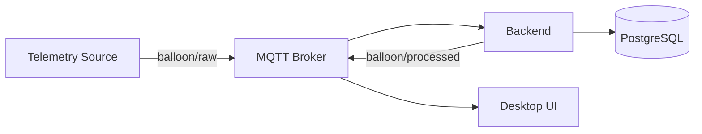

<div align="center">

# Ground Station

### A modular desktop prototype for balloon telemetry monitoring

Ground Station follows telemetry from its source to a live operator dashboard. It combines MQTT-based communication, persistent mission data, and a native desktop UI in one Docker-powered local environment.

[](https://www.python.org/)
[](https://www.docker.com/)
[](https://mqtt.org/)
[](https://www.postgresql.org/)
[](https://github.com/hoffstadt/DearPyGui)

</div>

## Overview

Ground Station is a local ground-control prototype for a balloon mission. It accepts telemetry, retains a history of the received data, prepares it for presentation, and displays the latest readings in a desktop dashboard.

The current application uses a simulated telemetry source, allowing the entire pipeline to run without flight hardware. The communication module is isolated from the rest of the system so that the generator can later be replaced by a real LoRa receiver.

## How It Works

Telemetry is generated once per second as a JSON message containing a timestamp, position, battery level, and pressure. The message is published to MQTT. Backend receives it, stores the original record, creates a processed payload for the interface, stores that version too, and publishes it back through MQTT. The desktop UI then refreshes its battery indicator and charts.



### Components at a glance

- **Communication** — generates the current test telemetry and publishes it to `balloon/raw`. A hardware-oriented LoRa prototype is included separately, but it is not the Docker entry point today.
- **MQTT Broker** — the event hub between services. It lets producers and consumers exchange telemetry through named topics without direct dependencies.
- **Backend** — subscribes to raw telemetry, produces the current dashboard payload, and persists raw and processed records.
- **PostgreSQL** — the active storage used by the running backend for mission telemetry history.
- **Desktop UI** — a Dear PyGui application that listens for processed telemetry and draws live status and charts.
- **AI** — an included Docker service reserved for future analysis. Its current implementation is a placeholder and is not part of the data flow.

## What You Can See Today

- Live **battery**, **altitude**, and **pressure** updates driven by MQTT messages.
- A top bar with local time, application uptime, and the latest battery percentage.
- A low-battery modal alert when battery level reaches **60% or below**.
- Raw and processed telemetry records persisted in PostgreSQL.
- A Docker Compose environment containing the broker, database, Communication, Backend, AI, and UI services.

The dashboard also contains a GPS panel and **Cut the Line** / **Reset Telemetry** controls. They are visual scaffolding at this stage and do not yet perform mission actions.

## Technologies

| Technology | Purpose |
| :-- | :-- |
| [](https://www.python.org/) | Application services and telemetry processing. |
| [](https://www.docker.com/) | Reproducible environment for the complete local stack. |
| [](https://mqtt.org/) | Lightweight telemetry transport between modules. |
| [](https://www.postgresql.org/) | Persistent raw and processed telemetry storage. |
| [](https://www.sqlalchemy.org/) | Database modelling and persistence layer. |
| [](https://github.com/hoffstadt/DearPyGui) | Native live telemetry dashboard. |

The repository also includes a JSON storage implementation and recursive validation helpers. They are available for development and future integration; the active runtime path currently uses PostgreSQL and does not invoke validation before persistence.

## Quick Start

### Requirements

- Docker Engine and Docker Compose
- Linux desktop session with X11 support for the native UI window
- `xhost` available on the host system

### Run the stack

```bash
git clone <repository-url>
cd ground-station
./start.sh
```

The executable `start.sh` grants the UI container local X11 access, builds the images, and runs Docker Compose. The terminal displays service logs and the **Pi Dashboard** should open as a native desktop window.

> **One-time database setup:** the current prototype keeps schema creation as a separate step. With a new PostgreSQL volume, open a second terminal after the stack starts and run:
>
> ```bash
> docker compose exec backend python storage/database/init_db.py
> ```
>
> Restart the stack with `Ctrl+C` and `./start.sh` if telemetry was sent before the tables were created.

Use `Ctrl+C` to stop the foreground stack. To remove stopped containers while keeping the database volume, run:

```bash
docker compose down
```

> The UI is not a browser application. macOS and Windows users need an X server and appropriate `DISPLAY` configuration, or can run the non-UI services only.

## Project Structure

```text
ground-station/
├── src/
│   ├── Communication/        # simulated telemetry and LoRa-oriented prototype
│   ├── Backend/              # MQTT processing, storage, validation helpers
│   ├── UI/                   # Dear PyGui dashboard and low-battery alert
│   ├── AI/                   # placeholder analysis service
│   └── config/               # shared MQTT topics and application settings
├── data/                     # development data and logs
├── tests/                    # database samples and MQTT experiments
├── docker-compose.yml        # complete local service stack
└── start.sh                  # Docker-based application startup
```

## Current Direction

Ground Station is structured to grow from a local simulation into a hardware-connected mission tool. The next areas of work include connecting live LoRa telemetry, wiring validation and alarm persistence into Backend, activating the AI service for analysis, and making UI controls part of a safe command workflow.

---

Built as a practical foundation for clear, reliable balloon-mission telemetry.
